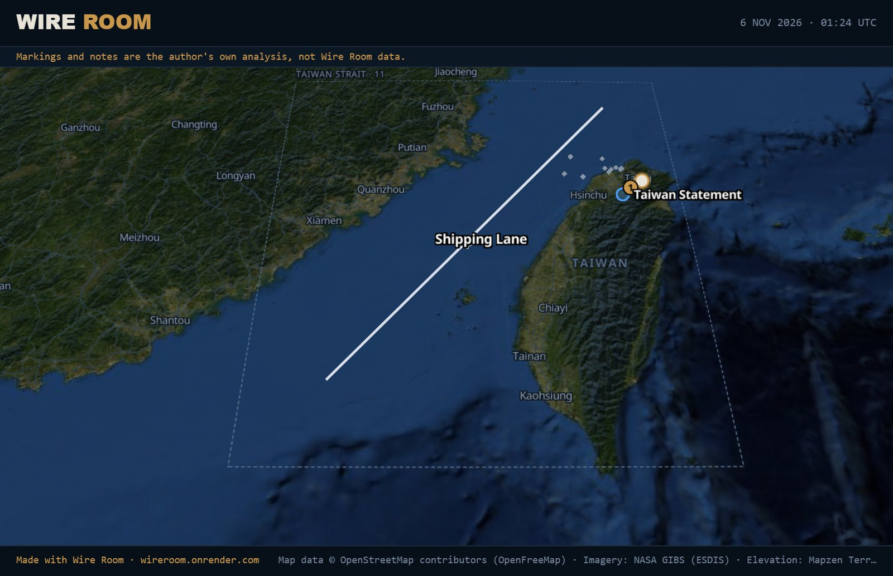

# Wire Room

[](https://github.com/wireroomapp/wireroom/actions/workflows/ci.yml)

**Live: [wireroom.onrender.com](https://wireroom.onrender.com)**



An interactive world map that shows what governments say next to what independent outlets report, country by country. Read both side by side, mark up the map, pin reports to markers, and export the result as an image.

**Status:** early access MVP. 20 of 29 countries have a verified government channel; the rest say so on screen.

## What it does

- **OFFICIAL / NEWS / BOTH:** each country's own government statements next to independent reporting, with the publisher named on every report.
- **Sources page:** where every country's reports come from, what "verified" means, and what isn't covered yet (`SOURCES` in the header).
- **Analyst canvas:** markers, lines, shapes and notes; pin any report, ship or aircraft to a marker; export the map as a PNG.
- **Trackers:** PLANES, SHIPS, MILITARY, TERRORISM and CYBER, each toggled on the map with its own icon. MILITARY shows wars from the UCDP Candidate Events Dataset (latest month's casualties with low/best/high range) plus strikes reported in the news; tapping a war draws a web to its latest attacks and opens a war intel panel (official statements from all sides Wire Room follows, plus outlet reports). TERRORISM and CYBER place attacks, threats and warnings reported in the last 10 days where the headline says they happened. Markers are reports, not verdicts: every card names its sources.
- **Cyber:** national cyber agencies (US CISA, UK NCSC, Japan JPCERT/CC) in those countries' official reports.
- **Live layers:** military aircraft (ADS-B) and ships at 10 maritime chokepoints and 5 Indian Ocean ports (AIS, hourly snapshots), with coverage gaps labeled.
- **Map:** flat or globe view, NASA imagery, 3D terrain.
- **Shareable links:** the address bar follows what's open, e.g. [`?country=ua&mode=both`](https://wireroom.onrender.com/?country=ua&mode=both) or [`?view=global`](https://wireroom.onrender.com/?view=global). The `LINK` button in the panel copies it.

## How it works

- **Frontend:** Vite + React (`src/App.jsx`). Deployed on Render as a static site.
- **Map:** MapLibre GL JS (`src/map/`), free and open source: OpenStreetMap data from OpenFreeMap (borders, roads, places), NASA GIBS imagery (Blue Marble, shaded relief, city lights), and AWS Terrain Tiles for hillshading and 3D terrain. Devices without WebGL fall back to the classic D3 map; `?engine=d3` forces it. No API keys or accounts needed.
- **Backend:** small Express server (`server.mjs`) that serves a pre-built cache. It never fetches news live.
- **Data pipeline:** a GitHub Action (`.github/workflows/fetch-news.yml`) runs `scripts/fetch-feeds.mjs` every hour. It pulls official government sources and independent publishers per country (`lib/feeds.mjs`) and commits the result to `data/cache.json`. The same job collects the ship snapshot (`data/ships.json`).
- **Official-source status:** each country is marked verified, temporarily unavailable, or not yet verified. The UI shows this instead of implying "no news". `/api/sources` (built by `lib/sources.mjs` from the same configuration) powers the Sources page.
- **Context data:** `scripts/collect-context.mjs` (in the same hourly job) writes `data/conflict.json` (UCDP, checked daily, CC BY 4.0) and `data/advisories.json` (US State Department); parsing and uncertainty fields are in `lib/context.mjs`. Files are only rewritten when their content changes.
- **Trackers:** `scripts/collect-incidents.mjs` runs next and writes `data/incidents.json` (reported strikes, terrorism and cyber incidents from the last 10 days, plus wars) and `data/war-intel.json` (each war's related reports). Classification, place-reading (from `lib/gazetteer.json`: GeoNames, OurAirports, Natural Earth) and grouping are in `lib/incidents.mjs`, tested in `tests/incidents.test.mjs`. Served at `/api/incidents` and `/api/war-intel?id=`.
- **Saved maps:** annotations are stored in the browser's localStorage. There are no accounts yet.
- **Translation:** after each fetch, `scripts/translate-reports.mjs` machine-translates recent non-English reports into English (`lib/translate.mjs`; DeepL or Microsoft Translator, chosen by the `TRANSLATE_API_KEY` repository secret and optional `TRANSLATE_PROVIDER` variable). Each report is translated once and remembered in `data/translations.json`; the original text is never changed, and the app shows it on request. A character budget keeps it inside free tiers.
- **Live layers:** served through `tracking/` so data providers can be swapped with environment variables. See [`tracking/README.md`](tracking/README.md).

```
src/            React app (App.jsx, map/, live layers, export, sources page, URL state)
lib/            source configuration and fetchers (feeds.mjs), sources description (sources.mjs)
tracking/       aircraft and ship providers behind one interface
scripts/        hourly collectors run by GitHub Actions
server.mjs      Express API serving the cached data
tests/          automated tests (node --test)
```

## Run locally

```
npm install
node server.mjs        # backend on http://localhost:3001
npm run dev            # frontend, in a second terminal
```

Point the frontend at a local backend with `VITE_API_BASE=http://localhost:3001`.

## Checks

Every push to `main` and every pull request runs lint, the automated tests and a production build ([`.github/workflows/ci.yml`](.github/workflows/ci.yml)). Locally:

```
npm run lint
npm test     # offline: live-layer backend, ship snapshots, annotation positions, source list, shareable links
npm run build
```

## Optional environment variables (frontend)

| Variable | Purpose |
| --- | --- |
| `VITE_API_BASE` | Backend URL (defaults to the deployed Render backend) |
| `VITE_FEEDBACK_URL` | Feedback form or `mailto:` link. Shows a FEEDBACK button when set |
| `VITE_GOATCOUNTER` | GoatCounter site code for privacy-friendly analytics |
| `VITE_MAP_ENGINE` | `maplibre` (default) or `d3` for the classic map |

Backend: `PROXY_URL` (optional) routes official-source fetches through a proxy for sites that block datacenter IPs. `GITHUB_DISPATCH_TOKEN` (fine-grained token, this repo only, Actions: read and write) turns on the watchdog in `scheduler/watchdog.mjs`, which starts the data job whenever GitHub's schedule lets it run more than 70 minutes late; `/api/status` shows the data's age and the watchdog's state. `AISSTREAM_API_KEY` turns on the ships layer; other live-layer switches are in [`tracking/README.md`](tracking/README.md).

## Known gaps

- Nine countries have no verified official source yet (AE, EG, ID, IR, NG, PK, SA, TR, ZA).
- Independent article links go through Google News redirects to the publisher.
- Up to 500 reports per type are kept per country; the report filter searches those only.
- Free aircraft and ship data have coverage gaps; ship positions are hourly snapshots, not live.
- Saved maps live in one browser; no accounts or sharing of maps yet.

## About

Built by Devin (Jango) Clements using AI-assisted development. Code review and issues are welcome.

## License

Copyright © 2026 Devin Clements. All rights reserved. The source is public so it can be read and reviewed; it is not licensed for reuse or redistribution. Data and imagery belong to their respective sources (see the Sources page and on-map credits).
